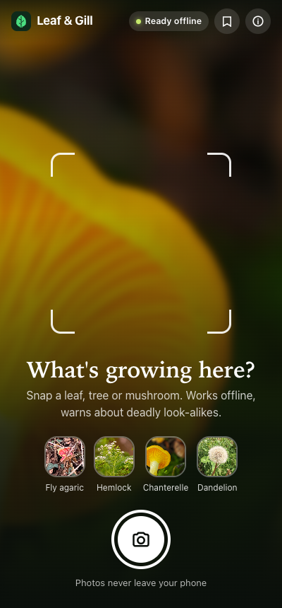
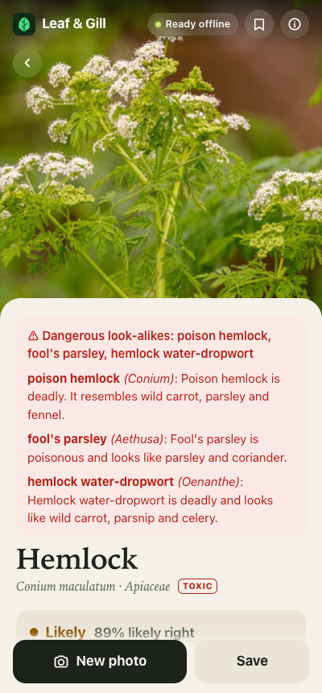
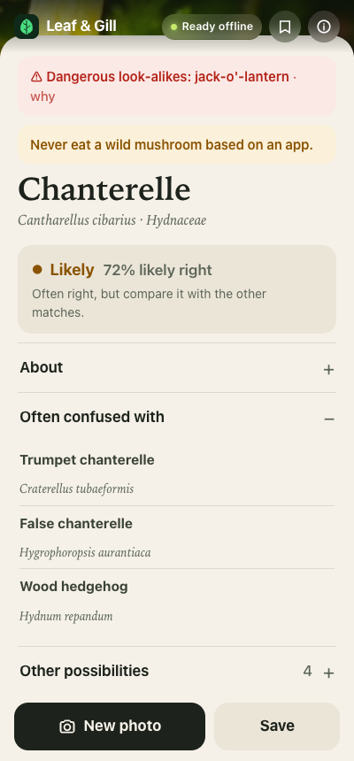

# Leaf & Gill

**Identify wild plants, trees and mushrooms offline, anywhere in the world.**
An open-source AI model runs inside your phone's browser. No signal, no account, no install, no photo ever uploaded.

**Try it:** https://mohamedaminehamdi.github.io/leaf-and-gill/
On an iPhone, open it in Safari and choose **Share → Add to Home Screen**.
The model is downloaded once (~600 MB, like offline maps) and works in airplane mode after that.

| Snap | Deadly look-alikes | Honest uncertainty |
|---|---|---|
|  |  |  |

## What it does

Point the camera at a leaf, a tree or a mushroom, then put the phone back in your pocket.

- **Top 5 matches** from 11,896 of the most-observed plants and fungi on Earth, never a single verdict.
- **A trust meter** (Very likely / Likely / Not sure) that knows when the model is guessing.
- **Red warnings for deadly look-alikes**, from a hand-written list of toxic genera:
  - When one is among the matches.
  - When one is a known look-alike of the top matches. For example, a photo the model calls *coriander* still warns about *poison hemlock*.
- **"Often confused with"**, computed from the model itself, plus real mix-ups measured on test photos.
- **A short "About"** from Wikipedia (attributed), with every sentence about eating removed.
- **A life list of your finds**, stored only on your phone.

It never says anything is safe to eat. Every mushroom result says: *never eat a wild mushroom based on an app.*

## How accurate is it?

Measured on **3,000 fresh iNaturalist research-grade photos observed after June 2025**, newer than the model's training data. Full report: [metrics.md](metrics.md).

| | Plants | Fungi |
|---|---|---|
| Right species as the top match (species in the pack) | 85.3% | 85.4% |
| Right species in the top 5 (species in the pack) | 97.4% | 96.6% |

**22% of real photos were species outside the pack.** That's why the trust meter matters.

The trust meter was learned with **TabPFN** on those photos and tested on held-out ones. It separates right answers from wrong ones better than the model's own score:
- **AUROC:** 0.843 vs 0.817.
- **Brier score:** 0.148 vs 0.167.

## How it works

```
BUILD TIME (laptop, online)                                         PHONE (offline)
GBIF: most-observed plants + fungi ──> species.json (11,896)  ─┐
BioCLIP 2 text tower ───────────────> text_emb.f16 (768-d)   ─┤   photo ─> BioCLIP 2 image tower (ONNX, WebGPU)
nearest species of other genera ────> lookalikes.json         ┼─> cosine vs 11,896 names ─> top 5
fresh iNaturalist photos ─> TabPFN ─> trust.json (3-D grid)   ─┤   ─> trust meter, danger check, cards
Wikipedia summaries (no food talk) ─> about.json              ─┘
```

- **Model:** [BioCLIP 2](https://huggingface.co/imageomics/bioclip-2) (Imageomics, MIT), trained on 200 million biology images. Its image tower is exported to ONNX fp16 (609 MB) and checked against the original (cosine 1.00000), then hosted at [mohamedaminehamdi/leaf-and-gill-bioclip2](https://huggingface.co/mohamedaminehamdi/leaf-and-gill-bioclip2).
- **Runtime:** [onnxruntime-web](https://onnxruntime.ai) with WebGPU, falling back to WebAssembly. It's served from this site, so it works offline. About 150–300 ms per photo on a laptop GPU.
- **App:** one HTML file and one JS module, no framework and no build step. A service worker caches the app; the model lives in Cache Storage.
- **No text is generated anywhere.** Names come from GBIF, descriptions from Wikipedia, and look-alikes and trust from measured data.

## Build the data yourself

```bash
uv run tools/build_species.py --plants 9000 --fungi 3000   # GBIF -> app/data/species.json
uv run tools/build_embeddings.py                            # BioCLIP 2 text tower -> text_emb.f16, lookalikes.json
uv run tools/build_about.py                                 # Wikipedia -> about.json
uv run tools/export_model.py                                # ONNX fp16 export + parity check (--upload USER/REPO)
uv run tools/eval_trust.py                                  # fresh iNaturalist photos -> accuracy + TabPFN trust.json
uv run pytest                                               # offline safety and data checks (also run by CI)
```

Serve `app/` with any static server and open it with `?model=<url>` to use your own copy of the model.

## Credits and licenses

- **Code:** MIT. See [LICENSE](LICENSE).
- **BioCLIP 2:** © Imageomics Institute, MIT.
- **Species and taxonomy:** [GBIF](https://www.gbif.org) (GBIF Backbone Taxonomy, CC BY 4.0).
- **Descriptions:** Wikipedia contributors, CC BY-SA 4.0. Each card links to its article.
- **Test photos:** iNaturalist observers, CC0 / CC BY / CC BY-SA. Used for evaluation only, not shipped.
- **Runtime:** [onnxruntime-web](https://github.com/microsoft/onnxruntime), MIT.
- **Trust meter:** built with [TabPFN](https://github.com/PriorLabs/TabPFN) (Prior Labs, TabPFN v2 weights).

Built for the [DEV Hacktoberfest Open-Source AI Challenge: Touch Grass](https://dev.to/challenges/hacktoberfest-week1-2026-10-05).
**Not a substitute for an expert. Never eat anything based on an app.**
